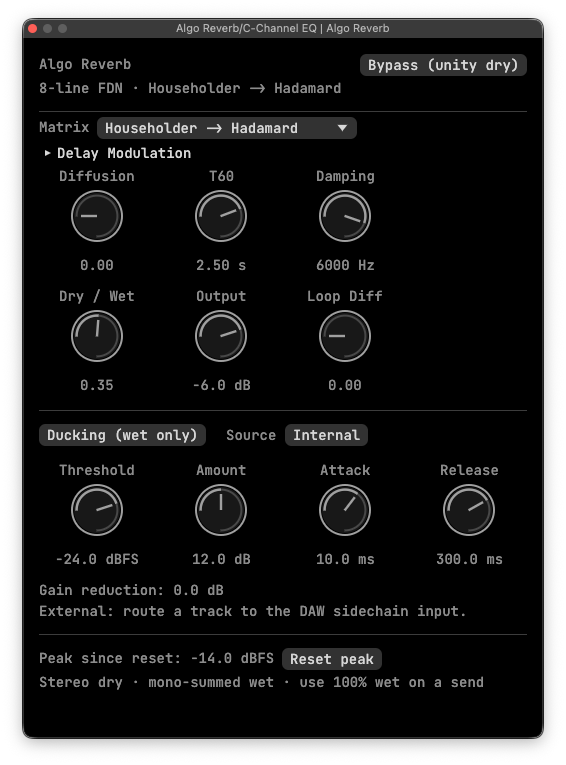

# algo_reverb

Algorithmic reverb in Rust with VST3 / CLAP plugins, a WAV audition app, and impulse response export.



## Setup

Requires Rust 1.88+ (1.95+ for plugins) and `just`.
Fetch and patch external dependencies before the first build:

```sh
just setup-ext
```

## Usage

### Plugins

```sh
cargo xtask bundle algo_reverb --release --features plugin
```

Bundles are saved to `target/bundled/`. Load them in a VST3 / CLAP-compatible DAW (AU is not supported).

### WAV audition app

```sh
cargo run --release --features gui --bin reverb-lab
```

Click **Open WAV…**, then **Play**. Start at a low volume.

### Impulse response export

```sh
cargo run --release -- hybrid /tmp/algo-reverb.wav 2.5
```

Arguments: matrix (`hadamard` / `householder` / `hybrid`), output path, and T60 in seconds.
Exports a wet-only, 48 kHz stereo WAV. Existing files are never overwritten.

## Tests

```sh
cargo test
```
