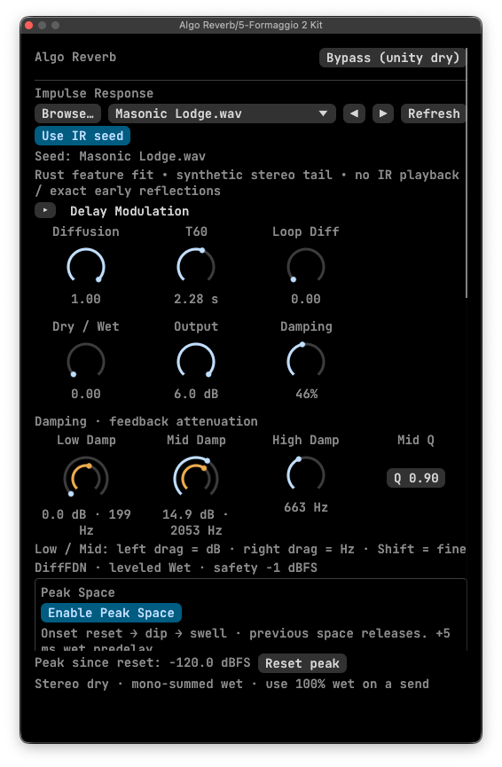
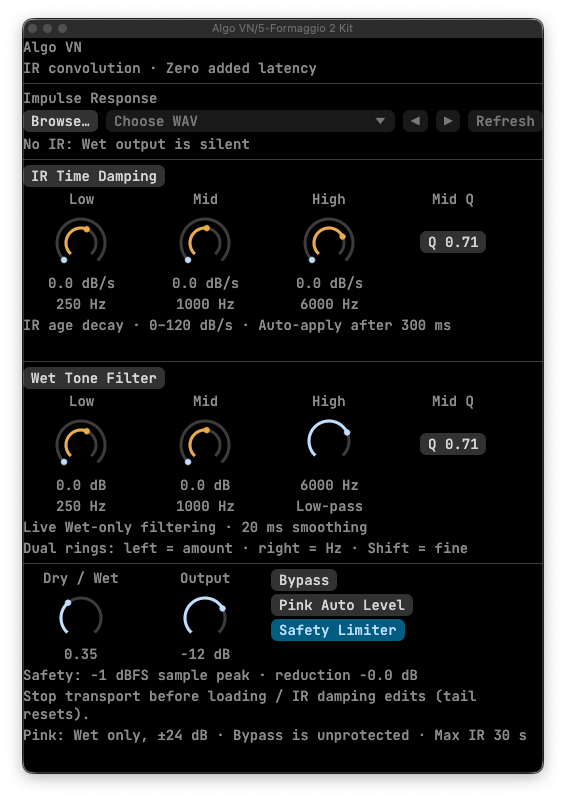

# Algo Reverb

Algorithmic and convolution reverb in Rust, with VST3 / CLAP plugins,
a WAV audition app, and offline impulse-response tools.

Algo Reverb is an **experimental plugin** I made purely as a personal hobby
and out of my own curiosity.

## Algo Reverb

Live DiffFDN reverb with two embedded rooms and Rust-only stereo IR-seed
feature fitting (no convolution).



## Algo VN

Convolution-only plugin with IR Time Damping and Wet Tone Filter.



## Quick start

Requires Rust 1.95+ for plugins and `just`. Run from the repository root:

```sh
just setup-ext
cargo xtask bundle algo_reverb --release --locked --lib --features plugin
# Optional: separate convolution plugin
cargo xtask bundle algo_vn --release --locked --lib
```

Bundles are written to `target/bundled/`. Load them in a VST3 / CLAP host
(AU is not supported). No IRs are bundled: bring your own WAV for convolution.
Stop transport before loading IRs, and start at low volume.

## Documentation

See the [user documentation](docs/README.md) for installation and plugin usage.

- [Installation](docs/installation.md)
- [Plugin usage and compatibility](docs/plugins.md)
- [Developer documentation](developer-docs/README.md): source builds, tests,
  Classic library / CLI, offline tools and historical research. This material
  and the optional research scripts are not included in plugin release archives.

## License

[MIT](LICENSE) for project code. See [third-party notices](THIRD_PARTY_NOTICES.md)
for embedded coefficient provenance and upstream licenses. User-supplied IRs and
exports containing copied reference samples remain subject to source terms.
